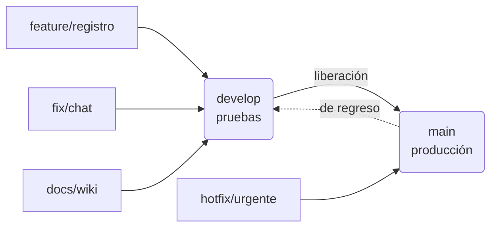

# 2 · El día a día

Cómo llevar un cambio desde tu computadora hasta `develop`, la rama de pruebas.

[← Instalar y correr en local](01-instalar-y-correr-local.md) · [Siguiente: Liberar a producción →](03-liberar-a-produccion.md)

---

## Las ramas



| Rama | Para qué | Sale de | Se une a | Cómo se une |
|---|---|---|---|---|
| `main` | Producción: lo que tienen los usuarios | — | — | — |
| `develop` | Pruebas: lo terminado, esperando liberarse | — | `main` | **Create a merge commit** |
| `feature/<nombre>` | Una funcionalidad: `feature/registro-4-pasos` | `develop` | `develop` | **Squash and merge** |
| `fix/<nombre>` | Corrección que no es urgente | `develop` | `develop` | **Squash and merge** |
| `docs/<nombre>` | Solo documentación | `develop` | `develop` | **Squash and merge** |
| `hotfix/<nombre>` | Algo roto en producción que no puede esperar | `main` | `main` y luego `develop` | **Create a merge commit** |

**Por qué dos formas de unir:**

- **Squash** (rama corta → `develop`): los 15 commits de "intento", "ya quedó", "ahora sí" se vuelven uno solo con un buen mensaje. `develop` se lee como una lista de funcionalidades.
- **Merge commit** (`develop` → `main`): las dos ramas comparten exactamente los mismos commits. Si aquí se aplastara, GitHub creería que `develop` tiene cambios "pendientes" que ya están en `main`, y cada liberación se volvería un enredo.

**Nombres de rama:** minúsculas, palabras separadas con guion, describiendo el qué: `feature/cancelar-con-motivo`, `fix/telefono-antes-de-confirmar`. Si viene del prototipo, puedes incluir la pantalla: `feature/a7-1-cancelar`.

---

## Paso a paso: un cambio

### 1. Parte de `develop` actualizado

```powershell
cd C:\dev\oficio
git checkout develop
git pull
```

### 2. Crea tu rama

```powershell
git checkout -b feature/registro-4-pasos
```

### 3. Trabaja y guarda

Haz commits pequeños, tantas veces como quieras:

```powershell
git add .
git status          # revisa que NO aparezca apps/api/.env ni node_modules
git commit -m "Pantalla A1.2: crear contraseña"
```

### 4. Si tocaste la base de datos

Nunca edites tablas desde Studio ni una migración existente. Siempre:

```powershell
npx supabase migration new nombre_del_cambio
# escribe el SQL en el archivo nuevo de supabase/migrations/
npx supabase db reset            # lo prueba desde cero
npm run db:types                 # regenera los tipos (súbelos en el mismo commit)
cd apps\api
npm run demo
npm run flujo                    # con npm run dev corriendo en otra ventana
cd ..\..
```

Usa `npm run db:types` y no el comando largo con `>` en PowerShell: PowerShell guarda el archivo en UTF-16 y la revisión automática lo vería distinto.

Antes de escribir la migración, lee [Migraciones seguras](04-produccion.md#migraciones-seguras): lo que cambies tiene que seguir funcionando con la versión de la app que ya está instalada.

### 5. Súbela

```powershell
git push -u origin feature/registro-4-pasos
```

### 6. Abre el pull request

1. En GitHub aparece el botón **Compare & pull request**. Si no aparece: pestaña *Pull requests → New pull request*, base `develop`, compare tu rama.
2. Revisa que el destino (**base**) sea `develop`.
3. La plantilla se carga sola: describe el cambio y marca la lista de revisión.
4. Clic en **Create pull request**.

### 7. Espera la revisión automática

Abajo del pull request aparecen las revisiones. Tardan de 5 a 8 minutos. Ver [Revisión automática](05-revision-automatica.md) para saber qué revisa cada una.

- **Todas en verde (✓):** sigue al paso 8.
- **Alguna en rojo (✗):** clic en *Details*, corrige en tu computadora, haz commit y `git push`. La revisión vuelve a correr sola.

### 8. Une y limpia

1. En GitHub: **Squash and merge** → ajusta el mensaje si hace falta → **Confirm**. La rama se borra sola en GitHub.
2. En tu computadora:

```powershell
git checkout develop
git pull
git branch -d feature/registro-4-pasos
```

---

## Si `develop` avanzó mientras trabajabas

Si otra persona unió cambios a `develop` y GitHub dice que tu rama está desactualizada o tiene conflictos:

```powershell
git checkout develop
git pull
git checkout feature/registro-4-pasos
git merge develop
# si hay conflictos: resuélvelos en el editor, luego git add . y git commit
git push
```

## Reglas que no cambian

- Nunca unir con la revisión en rojo.
- Nunca `git push` directo a `develop` ni a `main`: todo entra por pull request.
- Nunca editar una migración que ya existe.
- Nunca subir `apps/api/.env`, llaves o contraseñas. Si pasa por accidente, avisa de inmediato: hay que cambiar las llaves, porque borrar el commit no basta.
